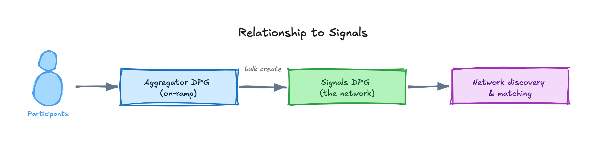

An **aggregator** is a local organisation that signs participants up and **checks their details**, so people nearby can find and trust their dots. The **Aggregator DPG** (digital public good) is the application aggregators use.

Checking details is the main reason aggregators exist. A dot that a known local organisation has checked is easier for the other side to trust.

## Who can be an aggregator

Any organisation that people in a group already know and trust. Pink, Green and Brown are possible future networks, so their rows are examples of who could take this role.

| Network | Organisations |
|---|---|
| Blue Dot (jobs) | Skilling centres and ITIs (Industrial Training Institutes) |
| Yellow Dot (education) | Schools, colleges and education NGOs |
| Purple Dot (persons with disabilities) | DPOs (disabled persons' organisations) and disability NGOs |
| Orange Dot (tourism) | Tourism bodies |
| Pink Dot (women's work, possible) | SHGs (self-help groups) |
| Green Dot (farming, possible) | FPOs (farmer producer organisations) and KVKs (Krishi Vigyan Kendras, farm science centres) |
| Brown Dot (small businesses, possible) | Trade associations |
| Any network | Government departments |

Picking the right aggregator is [step 1 of the lifecycle](/core-concepts/blue-dot-lifecycle/#1-decide-who-to-bring-in): the adaptor decides who to bring in, then picks the organisation that can reach them.

## Why aggregators matter

Asking every person to sign up on their own is slow. Aggregators already work with hundreds or thousands of people. When an aggregator registers and uploads its participants in bulk, a district quickly has enough dots for people to find useful matches. The Ghaziabad and Dharwad jobs pilots worked this way.

## What the Aggregator DPG does

The Aggregator DPG is aggregator-facing and provides:

- **Registration & approval** — an organisation registers, is reviewed, and is approved onto the network.
- **Organisation → coordinator hierarchy** — a parent organisation owns many coordinators, and coordinators join **by invitation only**. See [How coordinators join](#how-coordinators-join) below.
- **Profile management** — schema-driven forms (RJSF) let non-engineers change registration and profile fields without code changes.
- **Bulk upload** — CSV/file-based creation of many participant signals at once, processed asynchronously by a background worker.
- **Registration links & metrics** — shareable links for self-registration, with roll-up metrics.
- **Verification** — the review by a person that marks a checked profile as Verified.

## Intake methods

An aggregator can sign people up in four built-in ways: offline camp, bulk upload, outbound campaign and inbound QR campaign. The route (assisted or self) and the intake method are chosen per campaign or area. The [Dot Lifecycle](/core-concepts/blue-dot-lifecycle/#3-data-collection-assisted-route) describes each method.

## How coordinators join

Coordinators join an organisation by invitation only. The organisation owner registers, is approved, and then invites each coordinator by email. The full flow, including link lifetimes and recovery, is in [Aggregator DPG Architecture](/core-concepts/architecture/aggregator-dpg/#how-coordinators-join).

## The trust boundary

The Aggregator DPG reads from the upstream Signals stack and, in the MVP, has **no write access to Signals except through the controlled bulk-create paths**. Every request is scoped to a verified `aggregator_id`, which is **never trusted from the client** — it is asserted from the authenticated session. This keeps one aggregator from ever reading or writing another's data.

Integrating DPGs (such as the Aggregator app, or a voice DPG) authenticate to Signals with a **Keycloak service account**. See [Identity & Auth](/core-concepts/architecture/identity-and-auth/) for the full model.

## Relationship to Signals

<!-- Editable source: src/assets/diagrams/aggregators-relationship.excalidraw — open at https://excalidraw.com to adjust, re-export PNG here. -->

The Aggregator app brings participants in, and the Signals DPG stores and matches their dots. Adaptors usually stand up Signals first, then add the Aggregator app as partner organisations come on board.

## Where to go next

- [The Dot Lifecycle](/core-concepts/blue-dot-lifecycle/) — the seven steps an aggregator's participants go through.
- [Aggregator DPG Architecture](/core-concepts/architecture/aggregator-dpg/) — the API, portal and worker.
- [Aggregator DPG Setup](/guides/installation/local-setup/aggregator-dpg/) — install and run it.
