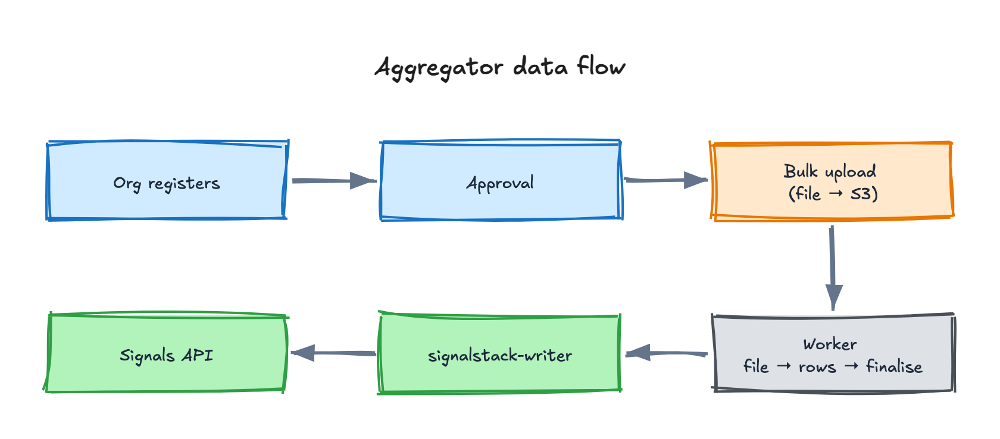

The **Aggregator DPG** is the aggregator-facing application of Blue Dots. It is a **pnpm + Turbo** monorepo, TypeScript-only, with three deployable apps.

The same portal signs up participants for any network the deployment serves.

## Three deployable apps

- **`api`** — Fastify backend-for-frontend. Owns the Aggregator database (Drizzle + Postgres), the Keycloak admin integration, and the registration/approval flow, bulk-upload entry point, registration links and profile endpoints. Reads the upstream Signals stack; in the MVP it has **no write access to Signals except via the bulk-create paths**. Every handler asserts `session.aggregator_id` — which is **never trusted from the client**.
- **`web`** — Next.js 15 (App Router) portal plus its own BFF. Anonymous flows use an `aggregator-bff` service-account token (client-credentials); authenticated flows attach the user's OIDC token. The session cookie carries only a session id — **access tokens are never written to cookies, they live in Redis only**. Forms are **RJSF-driven** from JSON schemas, so non-engineers can evolve registration/profile forms without code changes.
- **`worker`** — BullMQ jobs: `bulk-file-process`, `bulk-row-process`, `bulk-finalise`, `cron-watchdog`, `link-metrics-rollup`. Shares the same DB schema, S3 and the Signals writer. Cron-style jobs are watchdogged.

## Shared packages

Cross-package consumption goes through **subpath exports**. The common pattern: each service package exports `./interface` (an abstract class + Zod schemas), one or more concrete implementations (`./postgres`, `./http`, `./memory`), and `./testing` (in-memory fake + builders). Apps import only from `./interface` and `./testing`.

Key packages include `shared-primitives` (a `Result<T, E>` type, a typed error hierarchy, branded IDs, shared DTOs), `db-schema` (the single source of truth for tables), `signalstack-writer` / `participants-writer`, `queue` (BullMQ wiring) and config loaders.

## Architectural guardrails

These are enforced at CI by dependency-cruiser:

1. **`no-cross-service-impl-imports`** — cross-package imports must go through `./interface` or `./testing`.
2. **`no-heavy-deps-in-interface`** — interface files may only import `shared-primitives`, `zod` or `node:*`.

Other rules every package follows: every cross-package contract is an **abstract class** (not a TS interface, so it survives at runtime as a DI token); service methods return `Result<T, BaseError>` and **never throw** across a boundary; every external call has an explicit timeout, retry with backoff and a typed error.

## How coordinators join

Coordinators no longer register themselves against an organisation. Since the
org-hierarchy release they join **by invitation only**, so the organisation
owner decides who gets in.

The whole feature sits behind the per-instance **`ORG_HIERARCHY_ENABLED`** flag,
read at startup by **both** the API and the web app — set it identically on each.
With it off, the flat registration flow is unchanged and the org routes are not
registered at all (they return 404).

### The flow

1. **The organisation registers.** The owner opens `/register/owner` — a
   deep link, deliberately not advertised on the public registration page, so
   it reaches an owner by direct link or QR rather than by browsing.
2. **A reviewer approves it.** Approval is an atomic decision on the
   organisation record; it mirrors a Keycloak group and grants the owner the
   `org_owner` realm role.
3. **The owner receives an invite link.** The approval email carries a
   **90-day grant link** to `/register/invite?grant=…`. That page is the owner's
   only entry point: their Keycloak user stays **disabled** by design, so there
   is no account for them to sign in with.
4. **The owner invites coordinators by email.** Each recipient gets their own
   **one-time, 14-day invite**. The two lifetimes differ on purpose — a 14-day
   grant would strand an owner who cannot log in to request a new one.
5. **Each coordinator registers through their invite**, and is stamped with the
   organisation as their parent.

### If the owner loses the link

The grant is a signed token with no stored record, so there is nothing to look
up and resend. Two recoveries exist:

- **An expired grant is self-healing** — opening it and submitting mints a fresh
  link and emails it to the organisation's registered owner address.
- **Re-submitting the organisation registration** with the same owner email
  re-sends the link. This path is rate-limited per owner address, so a rapid
  second attempt is refused with a `Retry-After` instead of a fresh mail,
  because every admitted call mints another live 90-day credential. Mail always
  goes to the **stored** owner address, never the address on the new submission.
  That endpoint is anonymous, so honouring the submitted address would hand a
  stranger the organisation's credential.

### Why invitation-only

The organisation owner is accountable for who represents it on the network. Open
self-registration against a known organisation name would let anyone claim
affiliation. The aggregator's trust model depends on the platform setting
`aggregator_id` from the authenticated session; the client never supplies it.

## Data flow

<!-- Editable source: src/assets/diagrams/aggregator-dpg-data-flow.excalidraw — open at https://excalidraw.com to adjust, re-export PNG here. -->

See [Identity & Auth](/core-concepts/architecture/identity-and-auth/) for the shared realm and the service-auth handshake with Signals.
