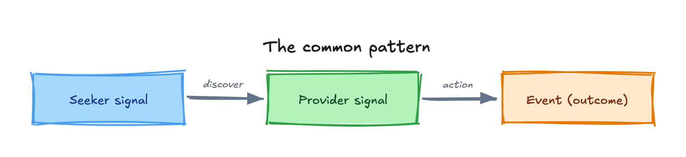

Blue Dots helps wherever people who need something and people who offer it are close by but don't know about each other. Each need runs as its own network with its own colour. Below is one example per dot. Blue comes first because it is the only network that is live today.

:::note
For the status of each dot and the sector it serves, see [The Dots Family](/explore/beyond-livelihoods/).
:::

## Blue Dots: jobs for young people

Status: **Live, piloted.** A young person registers by phone call in their language, and a skilling centre or ITI (Industrial Training Institute) verifies the profile. A nearby employer with a vacancy sees the profile and sends an interview invite. The young person accepts before their number is shared.

**Pilot evidence:** 10,000+ job openings found per district from under 10% of local MSMEs (micro, small and medium enterprises). Time to discover a relevant candidate fell from more than 2 weeks to under 2 days. Conversion was around 50% in targeted drives, against around 5% at conventional drives. See [Pilots](/explore/pilots/).

## Yellow Dots: tutoring and counselling

Status: **Network defined.** For example, a Class 12 commerce student asks for help with accounts, after a school or NGO helps them sign up. A tutor who teaches Class 12 commerce and will travel up to 5 km sends a connect request. The student accepts before contact details are shared.

## Purple Dots: support for persons with disabilities

Status: **Network defined.** For example, a person with a locomotor disability asks for a wheelchair and for help finding work. A disabled persons' organisation (DPO) helps them register. Providers in the same city who serve that disability see the request, such as an NGO that gives devices and a training centre. Either side sends a connect request, and the other accepts.

## Orange Dots: local tourism

Status: **Network defined.** For example, a homestay owner or a folk artist lists what they offer, with area, languages and price band. A tourism body verifies the listing. Visitors find it in the app and call the number shown. Orange listings and numbers are public on purpose, so no agreement step is needed.

## Pink Dots: work for women

Status: **Possible.** Finding suitable work close to home could raise women's labour-force participation, which is under 35%.

For example, a woman who stitches blouses at home could list her work, with her self-help group (SHG) vouching for her. Nearby boutiques could see it and ask to connect. Or a woman who could work if she had childcare could find a crèche near home. In each case she would accept before her number is shared.

The jobs pilot shows what "suitable" means. Around **75% of women will not proceed without clarity on three things**: safety, closeness to home, and workplace amenities or shift timings. Women also search far closer to home than men. See [What We're Learning](/explore/learnings/#7-women-are-asking-for-specific-assurances-before-taking-a-job).

## Green Dots: farming

Status: **Possible.** For example, a farmer could ask for a tractor for two days or a soil test. A farmer producer organisation (FPO) could help them sign up. A nearby custom hiring centre or soil-testing lab could see the request. The farmer would accept before contact.

## Brown Dots: small shops and suppliers

Status: **Possible.** For example, a kirana shop could ask for a regular supplier of packaged atta, after a trade association helps it sign up. Nearby wholesalers could see the request. The shop would accept before contact.

## Government schemes and services, on any dot

Scheme budget use sits below 70%, largely because eligible citizens never find the schemes meant for them. Service uptake runs at under 50% of potential. A government department can list its schemes and services as offers on any dot, so that eligible people nearby can find them.

## The common pattern

Every use case has the same shape:

{/* Editable source: src/assets/diagrams/use-cases-common-pattern.excalidraw — open at https://excalidraw.com to adjust, re-export PNG here. */}

A new use case needs a new **domain** and new **item schemas**, with no new system to build. See [The Dots Family](/explore/beyond-livelihoods/#how-a-new-colour-is-added).
